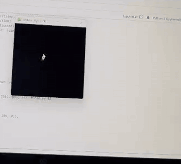

# Handwritten Digit Recognition

A neural network trained on MNIST that recognizes handwritten digits, plus a small **pygame app where you draw a digit with your mouse and the model predicts it live**.



## Results

| Metric | Value |
|---|---|
| Test accuracy (10,000 unseen images) | **98.0%** |
| Validation accuracy | 98.5% |
| Weakest classes | 8 and 9 (F1 = 0.96) |

The notebook includes a confusion matrix, per-class precision/recall, accuracy curves, and a look at the misclassified digits.

## Model

Fully connected network (MLP) in TensorFlow/Keras:

`Flatten(28x28) -> Dense(128, ReLU) -> Dense(64, ReLU) -> Dense(10, Softmax)`

Optimizer: Adam | Loss: sparse categorical crossentropy | Inputs normalized to [0, 1].

## Interactive app

Real drawings differ from MNIST, so `app.py` preprocesses the canvas the way MNIST was made: crop to the digit, resize to 20x20, place on a 28x28 canvas, and re-center by center of mass.

Controls: **hold left mouse** = draw, **Enter** = predict, **C** = clear.

## How to run

```bash
pip install -r requirements.txt
python train.py     # trains the model, creates digit_model.keras
python app.py       # opens the drawing window
```

Or open `notebook.ipynb` to see the full workflow with plots.

## Files

- `notebook.ipynb` - training, evaluation, error analysis
- `train.py` - standalone training script
- `app.py` - interactive drawing demo
- `assets/demo.gif` - screen recording of the demo

## Ideas for next steps

- Replace the MLP with a CNN (expected to reach ~99%+)
- Add data augmentation (shifts, rotations) to handle messy handwriting

## Author

Pariz - AI & Robotics Engineering student, Erbil Polytechnic University
